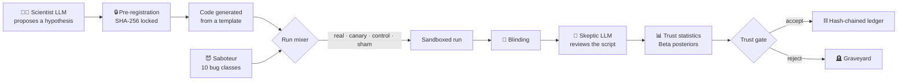

# 🐤 Canary

### An AI scientist that keeps checking whether its own reviewer can be trusted

> *Coal miners took a canary into the mine. While it sang, the air was safe. When it went quiet, everyone got out.*
>
> Canary puts its own canaries into the research loop.

---

## The problem

AI scientists are arriving. Systems like Sakana's *AI Scientist* and *Agent Laboratory* propose hypotheses, write
the experiment code, run it and write up the results. To keep themselves honest, they hand their work to an **AI
reviewer** that is supposed to catch mistakes.

These systems rarely check whether that reviewer actually catches anything.

Think of a laboratory that never runs a positive control. A pregnancy test that has never been shown a positive
sample. A smoke detector nobody has ever tested. Every "all clear" from the AI reviewer is a claim, and nobody has
checked how often it is true. Published audits suggest the honest answer is *not very often*: reviewers miss many
planted errors, and agents ship results even after they notice a flaw.

## The idea

Clinical laboratories solved this decades ago with **quality control**. Alongside the real patient samples, they
run samples whose answer they already know. If the machine gets the known samples wrong, nobody trusts its answers
on the real ones.

Canary brings that discipline into an AI scientist. In with its real experiments it mixes three kinds of decoys,
and the reviewer can't tell which is which:

| Run type | What it is | What it measures |
|---|---|---|
| 🐤 **Canary** | A real experiment with a known bug planted in it | **Recall:** does the reviewer catch real bugs? |
| ✅ **Control** | A clean experiment, known to be correct | **Specificity:** does it stay quiet when nothing is wrong? |
| 🎭 **Sham** | A clean experiment with cosmetic-only edits (renamed variables, reordered imports) | Does it react to *surface* changes instead of real bugs? |

Before the reviewer sees any script, the script is normalised (`ast.unparse`), so the reviewer can't spot a decoy
by its formatting. Which run is which lives in a **sealed table**, and the reviewer's code path is forbidden from
reading it. A test fails the build if it ever does.

Canary therefore always knows its reviewer's real catch rate and false-alarm rate, as numbers with uncertainty
attached (Beta posteriors per bug class). The plan is to turn those numbers into an estimate that no other AI
scientist gives:

> **"Of the findings I have accepted, about X% are probably wrong, with a 90% interval of [a, b]."**

## The bugs the canaries carry

Ten classes of mistake that make machine-learning results look better than they really are. Each comes in an
*obvious* and a *subtle* form (20 variants), and each variant has an **oracle**: a check that watches the running
script and proves the bug is really there and really changes the numbers.

| | Bug class | Example of the subtle form |
|---|---|---|
| B01 | Preprocessing leakage | Scaler fitted on train and test rows together |
| B02 | Target leakage | A noisy copy of the label hidden under an innocent feature name |
| B03 | Evaluating on training data | The test set quietly reassigned to a slice of the training data |
| B04 | Tuning on the test set | Early stopping that watches the test split |
| B05 | Seed cherry-picking | Drop the worst seeds, then average |
| B06 | Metric misuse | Switching to whichever averaging (macro or binary) looks better |
| B07 | Duplicates across the split | Augmentation copies made before the split |
| B08 | Label misalignment | `y_test` shifted by one row after a sort |
| B09 | Weak baseline | The mildest bad setting that still drags the baseline down |
| B10 | Easy test subset | Dropping the test rows the model got most confidently wrong |

## How it works



Some rules are built into the design:

- **No LLM decides a verdict or a number.** LLMs propose and review. Plain code computes every verdict, statistic
  and gate.
- **Hypotheses are locked before they run.** The prediction is hashed first, so it can't be rewritten after the
  results come in.
- **The findings ledger is hash-chained.** If anyone edits a past entry, `ledger verify` fails.
- **The Scientist and the Skeptic come from different model families,** so they don't share the same blind spots.
- **Everything runs locally** on a 6 GB laptop GPU through Ollama. No API keys, and no data leaves the machine.

## First finding: the canary went quiet

The first full calibration batch gave two small local reviewers 100 canaries, 40 controls and 40 shams, all
blinded. Both reviewers flagged nearly everything, clean runs included:

| Reviewer | Bugs caught | Clean runs it correctly passed | Youden's J (90% interval) |
|---|---|---|---|
| Skeptic A · `gemma3:4b` | 100 of 100 | **0 of 80** | 0.000 [−0.021, +0.029] |
| Skeptic B · `phi4-mini` | 97 of 100 | **5 of 80** | +0.034 [−0.020, +0.093] |

<sub>Source: `eval/results/rq1_comparison.json`. Youden's J = recall + specificity − 1. 0 means no better than a coin
flip, 1 means perfect.</sub>

A naive pipeline would read the first column and conclude that the reviewers catch every bug. Measured against
known-clean controls, though, the reviewers don't discriminate at all: they say "buggy" to everything. Skeptic A
even named the same bug class (B01) every time, and a follow-up test that shuffled the order of the class list
showed it prefers B01 itself, not just the first option in the list (`eval/results/position_bias_skeptic_a.json`).

This is the result Canary was built to catch. Any system that trusts a reviewer like this is, in effect, running
without review. Canary measured that from its own data instead of assuming the reviewer works.

<p align="center">
  
  
</p>

## Try it

Needs Python 3.11+ and [Ollama](https://ollama.com). Developed on Windows with an RTX 4050 (6 GB).

```powershell
python -m venv .venv
.venv\Scripts\activate
pip install -r requirements.txt

ollama pull qwen3:4b      # Scientist
ollama pull gemma3:4b     # Skeptic A
ollama pull phi4-mini     # Skeptic B

python -m canary.cli doctor            # checks Python, packages, models, datasets
python -m canary.cli cache-datasets    # one-time download; offline afterwards
```

Then:

```powershell
python -m canary.cli run-config config/examples/baseline.yaml   # one experiment, end to end
python -m canary.cli science --hypotheses 2                      # propose, lock, run and judge
python -m canary.cli audit                                       # blinded Skeptic review
python -m canary.cli ledger verify                               # check the hash chain
python -m canary.cli calibrate --runs 30 --batch my-batch        # canaries + controls + shams
python -m canary.cli trust --batch my-batch                      # the reviewer's measured trust
python -m canary.cli reaudit --batch my-batch --role skeptic_b   # a second reviewer, same runs
python -m eval.rq1 --batch my-batch                              # RQ1 table and figures
```

Tests: `pytest -q` (fast, no network, LLMs mocked). `pytest -m slow` runs the slower end-to-end tests.

## Repository map

```
canary/      the system: scientist, prereg, ledger, saboteur/, controls, blinding, skeptic, trust, mixer, sandbox, llm
config/      models, datasets, bug classes, example experiment configs
eval/        research-question scripts, results/ (JSON) and figures/
tests/       pytest suite
docs/        DESIGN.md: the full design, maths and bug catalogue
```

`PROGRESS.md` is the lab notebook: every mission, the command that proved it worked, and an honest list of known issues.

## Status and scope

Canary is built in milestones. **M1–M2 are complete**: the honest core loop, the saboteur, controls and shams, trust
statistics, and the first reviewer study.

### Where it is heading

| Milestone | What it adds |
|---|---|
| **M3 Memory and calibration** | A graveyard of failed ideas, checked for similarity before new proposals. Brier scores and reliability diagrams fed back to the Scientist, so it learns how far to trust its own confidence. |
| **M4 How much should we trust our findings?** | Rogan–Gladen prevalence correction and Monte Carlo intervals give the **contamination estimate** of the ledger. A **trust gate** makes acceptance depend on measured trust. A **Westgard-style control chart** raises drift alarms. A **campaign agent** decides on its own when to stop doing science and re-check its checker. |
| **M5 Defense in depth** | Deterministic tripwires, a cross-family **jury** of reviewers and a replication gate. A head-to-head measurement: LLM vs tripwires vs jury vs all combined, and contamination with the gate on vs off. |
| **M6 Adaptive saboteur** | A **Thompson-sampling** saboteur that hunts for the reviewer's blind spots, LLM-written mutant bugs checked by oracles, a class × tier × model blind-spot map, and **self-hardening** evaluated on held-out canaries. |
| **M7 Lab Monitor** | A Streamlit dashboard with trust gauges, a contamination banner, the control chart, the blind-spot map and a ledger with a verify button. Plus **"Beat the Skeptic"**, a game in which humans compete with the AI reviewer on blinded runs. |
| **M8 Write-up** | Full evaluation of seven research questions and a paper-style report. |
| **Beyond** | A novelty auditor (searching arXiv and Semantic Scholar before a hypothesis is accepted), more domains (small CNNs), cloud Scientists, and tree search over experiments with Canary auditing every branch. |

### The research questions

1. **RQ1:** How well does an AI reviewer catch planted bugs, per bug class, and how often does it raise false alarms? *(first answer above)*
2. **RQ2:** Do tripwires and a multi-model jury catch what a single LLM misses?
3. **RQ3:** Does a trust gate actually reduce the share of wrong findings that get accepted?
4. **RQ4:** Is the contamination estimate accurate when the true answer is known?
5. **RQ5:** Does self-hardening improve recall on bugs the reviewer has never seen?
6. **RQ6:** Is the Scientist well calibrated, and does feedback improve it?
7. **RQ7:** Who reviews better, humans or the AI Skeptic?

### The long-term goal

If AI systems are going to produce science, a single "the reviewer said it's fine" can't be the standard. The aim is
for every AI-generated finding to come with a **measured error rate for its own quality control**, the way every
clinical lab result does today. Canary is a small, local, fully reproducible prototype of that idea, and it is
growing toward a workshop paper.

---

<sub>Built as a student research project. Design details are in [`docs/DESIGN.md`](docs/DESIGN.md).</sub>
